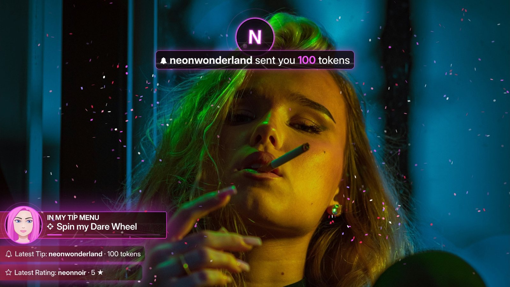

# Neon Noir Stream Widgets (beta)

Hey, I'm **Neon Grey** 💜 I stream on **webcammodels.com / cammedia.com**, and at some point I got tired of my stream looking like every other stream. So I built myself a little neon toolbox. It worked so well that I'm sharing it with you.

Here's the idea in three sentences:

1. **Better picture.** Instead of handing the site your raw webcam, you let **OBS** build your stream and send it out as a **virtual webcam**. Same camera, same room, but suddenly you get lighting tweaks, crops, scenes and overlays, and your whole stream just looks *better*.
2. **The browser extension listens.** It sits in your browser next to the chat and passes everything that happens there (tips, ratings, slot spins, dice rolls, tip menu requests, and the room chat if you want it on stream) on to the app. Bonus: it also asks your camera for 1080p and switches off the voice filter, so your music comes through clean instead of sounding like a phone call.
3. **The app puts on the show.** The overlay app (for **macOS and Windows**) runs quietly in the background and serves little local web pages with all the widgets. You add them to OBS as a browser source, and they light up right on your stream.

> **🔒 Your stuff stays yours.** No accounts, no tracking, no analytics. The app and the extension don't collect or send anywhere what you or your viewers do. Everything runs locally on your computer: the extension talks only to the app (via `localhost`), and the app talks only to OBS. Only two little things go online: a peek at this GitHub page (when the app starts and every 6 hours) to see if there's an update, and (Mac) when a song has no cover art, the app asks Apple's iTunes search for one using just the song title and artist.
>
> *My lawyer just cleared his throat, so: this describes what the app does, it is no legal promise in the actual sense.*

### What lights up on your stream

- **Chat events with faces:** tip and 5-star rating banners with the sender's animated avatar, slot and dice animations, confetti. Lots of confetti.
- **[Dare Wheel](docs/features.md#the-dare-wheel):** a viewer tips, *you* are the dial, and the beam picks one of your six dares.
- **[Dice Duel](docs/features.md#the-dice-duel):** a viewer plays dice against you, first to 3. Muahaha.
- **[Tip Action Teaser](docs/features.md#the-teaser):** a little side pill that tells everyone what's on your tip menu.
- **[Be right back](docs/features.md#be-right-back):** a full-screen away screen, even with live chat, for when you need to pee. Sorry. For when you need to *powder your nose*.
- **[Room chat on stream](docs/features.md#room-chat-on-stream):** the site's chat, with avatars and emojis.
- **Now playing** (macOS only): your Apple Music track with cover and progress bar.
- **[Themes](docs/features.md#themes):** Neon Noir Dark (neon at night) and Light (the same street by day).
- **HD webcam + clean audio:** thanks to the extension, see above.

Everything has its own on/off switch, so you only show what you want.

### Get started

1. **[Basic setup](docs/setup.md):** OBS, OBS as your webcam, and (Mac) music on your stream. Once, then it's just there.
2. **[Install the widgets](docs/install.md):** download, app, browser extension, pairing, one OBS source. Five steps.
3. **[Features](docs/features.md):** switch on what you like and set up your tip actions.
4. Something off? **[Troubleshooting](docs/troubleshooting.md)** has you covered.

Downloads are always on the **[latest release](https://github.com/neongreycodes/neon-noir-stream-widgets/releases/latest)** page.

> **Windows friends:** Windows is still **experimental**. The app installs and connects to the extension, but I haven't fully tested the overlays on Windows yet, and there's no music widget there yet. If you're on Windows, your feedback helps me the most.

> **This is a beta.** Things may still break, and that's okay, that's what betas are for. If something acts weird or you have an idea, tell me: DM me on webcammodels.com when I'm online, send Fan Mail when I'm offline, or open a [GitHub issue](https://github.com/neongreycodes/neon-noir-stream-widgets/issues). The log helps me a lot (see [Troubleshooting](docs/troubleshooting.md)). Thanks for testing! 🖤

### Talk to me 💬

I'm curious about everything: what works, what feels clunky, where setup got you stuck, what you think of the colours, fonts and animations on stream, and which widget you'd love to see next. Using a widget on your stream? Show me, I'd love to see it! 💜

- **Found a bug?** Open an [issue](https://github.com/neongreycodes/neon-noir-stream-widgets/issues).
- **Ideas, questions, show and tell?** Come hang out in [Discussions](https://github.com/neongreycodes/neon-noir-stream-widgets/discussions).
- No question is too small, and beginners are very welcome. Be kind and open-minded: everyone is welcome here, whoever you are. 🌈

---

Music overlay based on [apple-music-obs-overlay](https://github.com/m-shintaro/apple-music-obs-overlay) by Shintaro Matsumoto (MIT). App, extension and overlays use the Inter Display font (SIL OFL 1.1) and Font Awesome 4.7 (SIL OFL 1.1 / MIT); the overlays also use canvas-confetti (ISC).

Made with love (and too much neon) by Neon Grey. 💜
