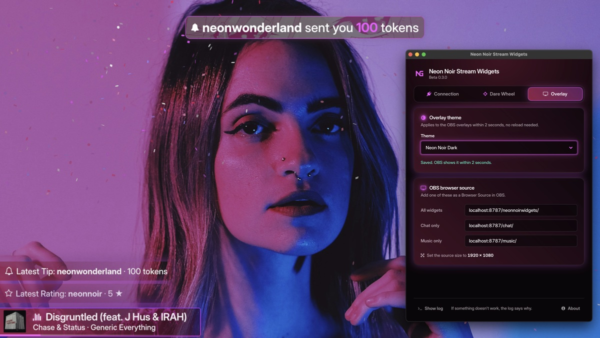
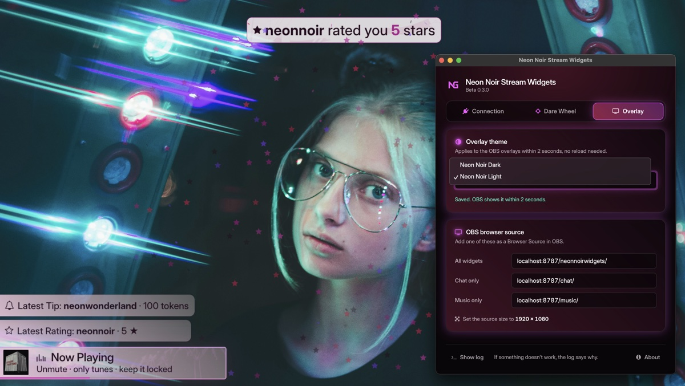
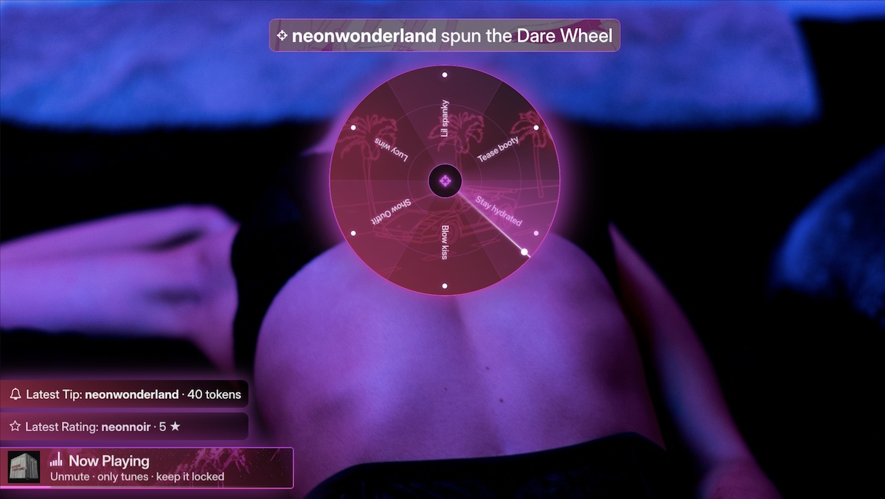

# Neon Noir Stream Widgets (beta)

Hey, I'm **Neon Grey** 💜 I stream on **webcammodels.com / cammedia.com**, and at some point I got tired of my stream looking like every other stream. So I built myself a little neon toolbox. It worked so well that I'm sharing it with you.

Here's the idea in three sentences:

1. **Better picture.** Instead of handing the site your raw webcam, you let **OBS** build your stream and send it out as a **virtual webcam**. Same camera, same room, but suddenly you get lighting tweaks, crops, scenes and overlays, and your whole stream just looks *better*.
2. **The browser extension listens.** It sits in your browser next to the chat and passes everything that happens there (tips, ratings, slot spins, dice rolls, tip menu requests) on to the app. Bonus: it also asks your camera for 1080p and switches off the voice filter, so your music comes through clean instead of sounding like a phone call.
3. **The app puts on the show.** The overlay app (for **macOS and Windows**) runs quietly in the background and serves little local web pages with all the widgets. You add them to OBS as a browser source, and they light up right on your stream.

> **🔒 Your stuff stays yours.** No accounts, no tracking, no analytics. The app and the extension don't collect or send anywhere what you or your viewers do. Everything runs locally on your computer: the extension talks only to the app (via `localhost`), and the app talks only to OBS. Only two little things go online: a peek at this GitHub page (when the app starts and every 6 hours) to see if there's an update, and (Mac) when a song has no cover art, the app asks Apple's iTunes search for one using just the song title and artist.
>
> *My lawyer just cleared his throat, so: this describes what the app does, it is no legal promise in the actual sense.*

### What lights up on your stream

- **Chat events:** banners for ratings and tips, your latest rating and tip, slot machine and dice animations with confetti. Lots of confetti.
- **Dare Wheel:** a viewer tips for your tip menu item (e.g. "Spin my Dare Wheel"), a wheel spins on your stream and lands on one of your dares. Between spins, a small teaser card reminds everyone it's there, just waiting.
- **Now playing** (macOS only): the current Apple Music track with its cover and a progress bar.
- **Themes:** Neon Noir Dark (the default, neon at night) and Neon Noir Light (the same street by day).
- **HD webcam + clean audio:** thanks to the extension, see above.

> **Windows friends:** the app installs and connects to the extension, but I haven't fully tested the overlays on Windows yet. If you're on Windows, your feedback helps me the most.

> **This is a beta.** Things may still break, and that's okay, that's what betas are for. If something acts weird or you have an idea, tell me: DM me on webcammodels.com when I'm online, send Fan Mail when I'm offline, or open a [GitHub issue](https://github.com/neongreycodes/neon-noir-stream-widgets/issues). The log helps me a lot (see [Troubleshooting](#troubleshooting)). Thanks for testing! 🖤

### Talk to me 💬

I'm curious about everything: what works, what feels clunky, where setup got you stuck, what you think of the colours, fonts and animations on stream, and which widget you'd love to see next. Using a widget on your stream? Show me, I'd love to see it! 💜

- **Found a bug?** Open an [issue](https://github.com/neongreycodes/neon-noir-stream-widgets/issues).
- **Ideas, questions, show and tell?** Come hang out in [Discussions](https://github.com/neongreycodes/neon-noir-stream-widgets/discussions).
- No question is too small, and beginners are very welcome. Be kind and open-minded: everyone is welcome here, whoever you are. 🌈

---

# Part 1: The basic setup

Before the widgets, let's get the stage ready. You do this once, then it's just there.

## A. Install OBS

OBS is free, and it's what turns your webcam into a proper stream.

1. Download it from **[obsproject.com](https://obsproject.com)** (macOS or Windows) and install it.
2. Open it. If the auto-configuration wizard pops up, pick **Optimize just for virtual camera**, or close it and continue below.
3. Open **Settings → Video** and set **Base (Canvas) Resolution** and **Output (Scaled) Resolution** to `1920x1080`. That matches the widgets and the 1080p the extension asks for.
4. In your scene, add a **Video Capture Device** source and pick your webcam. Make it fill the canvas (right-click → **Transform → Fit to screen**).

## B. Turn OBS into your webcam

1. In OBS, click **Start Virtual Camera** (in the **Controls** dock, bottom right).
2. **Mac only, first time:** macOS asks to allow the OBS camera extension. Say yes, and if it sends you to **System Settings**, allow it there and restart OBS. Then click **Start Virtual Camera** again.
3. On the chat site, open your broadcast settings and pick **OBS Virtual Camera** as your camera.

Now whatever OBS shows is what your viewers see, widgets included once you've added them in [Part 2](#5-add-it-to-obs). OBS has to stay open with the virtual camera running while you stream.

## C. Music on your stream (macOS)

Want your Apple Music playing in the background of your show? (Anything goes. Except Madonna. She's cryo-frozen until her next show anyway, let her rest.) The trick: route it through a **virtual audio device** and let the site use that device as your **microphone**.

Heads up: this is **pure music, no voice**. That's my setup and it's what I use. If yours looks different, you'll have to figure that part out yourself. 😉

> **My comfy tip:** use an **external Bluetooth speaker with its own volume knob**. This audio routing switches off the macOS volume control, so otherwise the only way to make it quieter in your room is to turn it down in Apple Music, and that turns it down for your viewers too. With a speaker you set your room volume on the speaker, and the stream stays happy.
>
> *This is no audio-engineering advice in the actual sense.*

1. Install **[Background Music](https://github.com/kyleneideck/BackgroundMusic)** (free). It adds a virtual audio device called **Background Music**.
2. Open the **Audio MIDI Setup** app (Applications → Utilities). Click **+** at the bottom left → **Create Multi-Output Device**, and tick **Background Music** plus the speaker you want to hear it on (your Bluetooth speaker, or the internal speakers).
3. Open **System Settings → Sound**. Under **Output**, pick the new **Multi-Output Device**. Under **Input**, pick **Background Music**.
4. In Chrome, on the chat site, pick **Background Music** as your **microphone**.

Now your music plays in your room *and* goes straight into your stream. Keep the browser extension running: it switches off the browser's voice filtering, which otherwise squashes music into something tinny. With it, your playlist sounds the way it should. 🎶

---

# Part 2: Install the widgets

## 1. Download

Open the **[latest release](https://github.com/neongreycodes/neon-noir-stream-widgets/releases/latest)** and download, under *Assets*:

| You have | Download |
| --- | --- |
| a Mac (any, Intel or Apple Silicon) | `Neon.Noir.Stream.Widgets_…_universal.dmg` |
| a Windows PC | `Neon.Noir.Stream.Widgets_…_x64-setup.exe` |
| either | `neon-noir-stream-widgets-extension-….zip` (the browser extension) |

You need **Chrome, Edge or Brave** for the extension, and **OBS** (which you already have from [Part 1](#a-install-obs)).

---

## 2. Install the app

The app is the heart of it all. Install it once and forget it's there.

### Mac

1. Open the `.dmg` and drag **Neon Noir Stream Widgets** into **Applications**.
2. Open it from Applications. macOS says it **can't check the app** ("unidentified developer"). That's expected, don't panic: the beta isn't registered with Apple (yet). My lawyer advised me not to comment further on Apple's paperwork. Click **Done**.
3. Open **System Settings → Privacy & Security**, scroll down, and click **Open Anyway** next to "Neon Noir Stream Widgets". Confirm with your password. You only do this once.
4. When music plays, macOS asks whether the app may **control "Music"**. Click **OK**: that's how it reads the current track.

### Windows

1. Run the `…-setup.exe`. Windows shows **"Windows protected your PC"**. That's expected for the beta: click **More info → Run anyway**.
2. Follow the installer.

On Windows there is **no music widget yet**: the chat overlay works, the now-playing card doesn't appear. It's on my list.

### Where the app lives

Closing the settings window does **not** stop the app (that's on purpose): it keeps running in the background so your overlays keep working. To get the window back or to quit, click the **NG** icon:

- **Mac:** in the menu bar at the top right (clicking the app's Dock icon also opens the window).
- **Windows:** in the system tray at the bottom right (maybe behind the **^** arrow).

It offers **Open settings** and **Quit**.

---

## 3. Install the browser extension

The extension is your little spy in the chat. A friendly one.

1. Unzip `neon-noir-stream-widgets-extension-….zip`. You get a folder **neon-noir-stream-widgets-extension**. Put it somewhere it can stay (e.g. your Documents). **Don't delete it later**: the browser loads the extension from there.
2. In the browser, open `chrome://extensions` (Edge: `edge://extensions`, Brave: `brave://extensions`).
3. Turn on **Developer mode** (a switch: top right in Chrome and Brave, on the left in Edge).
4. Click **Load unpacked** and choose the **neon-noir-stream-widgets-extension** folder.
5. Click the puzzle piece in the toolbar and **pin** Neon Noir Stream Widgets, so its icon is always visible.

---

## 4. Set it up

1. Open the app's settings (NG icon → **Open settings**). On every start it first shows a short **beta notice**: click **Agree & continue** (**About**, bottom right, shows it again). The window has three tabs: **Connection**, **Dare Wheel** and **Overlay**. It opens on Connection the first time.
2. **Chat username** (Connection tab): your name on the chat site, then **Save**. The app needs it to recognise *your* slot spins, dice rolls, ratings and tip menu requests.
3. **Pairing code** (Connection tab): the app shows a code like `K7QM-4XPA`. Click the extension icon in the browser, type the code and click **Pair**. The popup now says **Connected to the app** and shows your username.
4. **Overlay theme** (Overlay tab): pick the look you like; **Neon Noir Dark** is the default. It changes in OBS within 2 seconds.

The pairing code makes sure only *your* extension can send events to your overlays. Nobody else gets to throw confetti on your stream.

---

## 5. Add it to OBS

Time to see it glow.

1. In your scene, add a **Browser** source (on top of your webcam).
2. **URL:** `http://localhost:8787/neonnoirwidgets/`
3. **Width** `1920`, **Height** `1080`.
4. OK.

That one source shows everything. If you'd rather place chat and music separately, use two browser sources with `http://localhost:8787/chat/` and `http://localhost:8787/music/` (same size).

The app must be running while you stream. Without it, the browser source stays empty. Because you're sending OBS out as your virtual webcam (see [Part 1](#b-turn-obs-into-your-webcam)), the widgets now show up on the site too.

---

## 6. Dare Wheel (optional)

My favourite part. Let your viewers spin a wheel that picks one of your dares, and watch the chat go wild.

Yes, the site has its own dare game. Mine is just better, sorry not sorry:

- **Your price, your rules.** You set the token price for a spin. The site's version is always 10 tokens.
- **Up to six dares, not exactly six.** Got three good ones? Use three. The site insists on all six.
- **It's a damn spinning wheel.** In neon. With confetti. Need I say more? 😎

1. **On the chat site:** add an item to your **tip menu**, e.g. `Spin my Dare Wheel`, with any token price you like.
2. **In the app** (Dare Wheel tab): type the **same text** in **Trigger**. Upper and lower case don't matter, but the words must match exactly. Easiest: send the request once yourself, then click **Use as trigger** next to "Last request".
3. Fill in up to **six dares** (empty fields are skipped) and click **Save**.
4. Turn the **Dare Wheel** switch **on**.
5. Click **Test spin** to see it in OBS without a tip.

When a viewer tips for that item, the wheel appears on your stream, spins for about 5 seconds, lands on one dare, and a big card shows it with confetti (about 18 seconds in all). Every tip menu request also updates "Latest Tip". While the Dare Wheel is on, a small **teaser** card above "Latest Tip" shows your tip menu item and cycles through your dares. Set it in the **Teaser** line: on/off, and **always** (on screen between spins) or **every** 1–60 minutes for 5–60 seconds (default: every 2 minutes for 20 seconds). **Preview teaser** shows it right away.

---

## Updates

I keep improving things, so check back now and then. When a new version is out, the app's settings window and the extension popup show **"Update available"**. Then:

- **App:** download the new `.dmg` / `-setup.exe` from the [latest release](https://github.com/neongreycodes/neon-noir-stream-widgets/releases/latest) and install it over the old one. Your settings stay.
- **Extension:** unzip the new extension and replace the **contents** of your extension folder with it. Then open `chrome://extensions` and click the **reload** arrow on the extension.

---

## Troubleshooting

Something's off? Don't worry, most hiccups are quick to fix.

| Problem | What to do |
| --- | --- |
| The extension popup says **App not running** | Start the app (Applications / Start menu). |
| The popup says **Not paired** | Enter the pairing code from the app's settings window again. |
| Ratings and tips appear, but **slots / dice don't** | Check the **chat username** in the app: it must match your name on the chat site. |
| The **Dare Wheel doesn't spin** on a tip | Is the Dare Wheel switch **on** and at least one dare filled in? Does "Last request" in the Dare Wheel tab show the request? Then click **Use as trigger** and **Save**. Still nothing: **Show log**, it says why. |
| The browser source in OBS is **empty** | Is the app running? Is the URL exactly `http://localhost:8787/neonnoirwidgets/`? Right-click the source → **Refresh**. |
| **Mac:** no music card | Music must be playing in the **Music** app. If you clicked "Don't Allow" before: System Settings → Privacy & Security → Automation → Neon Noir Stream Widgets → turn on **Music**. |
| The site doesn't offer **OBS Virtual Camera** | Click **Start Virtual Camera** in OBS first, then reload the chat site's page. **Mac:** check that the OBS camera extension is allowed in System Settings. |
| Viewers **don't hear the music** (Mac) | Is **Background Music** picked as the microphone on the site? In System Settings → Sound, is the output the **Multi-Output Device** and the input **Background Music**? Is the extension running? |
| Something else | In the app's settings window, click **Show log** and send me the `app.log` file (DM, Fan Mail or a GitHub issue). |

---

Music overlay based on [apple-music-obs-overlay](https://github.com/m-shintaro/apple-music-obs-overlay) by Shintaro Matsumoto (MIT). App, extension and overlays use the Inter Display font (SIL OFL 1.1) and Font Awesome 4.7 (SIL OFL 1.1 / MIT); the overlays also use canvas-confetti (ISC).

Made with love (and too much neon) by Neon Grey. 💜
