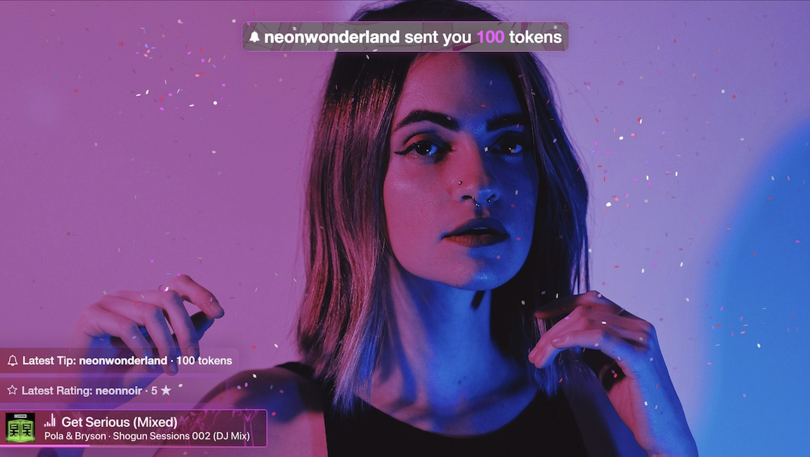
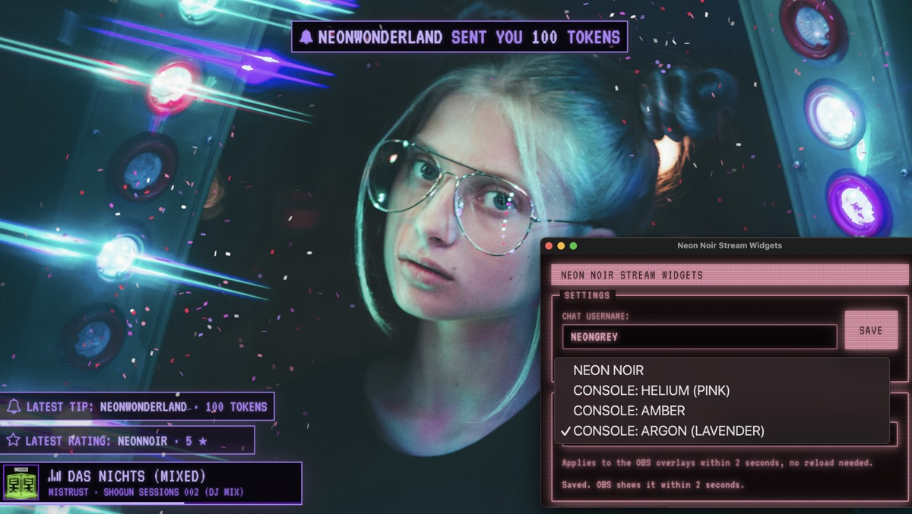
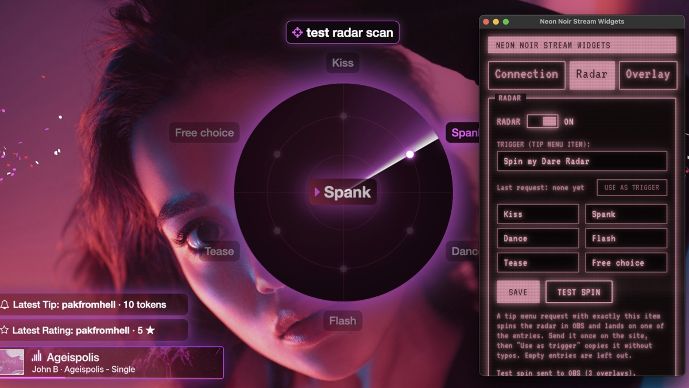

# Neon Noir Stream Widgets (alpha)

Stream overlays for **webcammodels.com / cammedia.com** in OBS (or any streaming app with a browser source):

- **Chat events:** banners for ratings and tips, your latest rating and tip, slot machine and dice animations with confetti.
- **Dare Radar:** a viewer tips for your tip menu item (e.g. "Spin my Dare Radar") and a big radar sweeps across your stream and lands on one of your dares. Between spins, a small card reminds viewers it's there.
- **Now playing** (macOS only): the current Apple Music track with its cover and a progress bar.
- **Themes:** Console Helium (pink), Amber and Argon (lavender).
- **HD webcam + clean audio:** the browser extension asks your camera for 1080p and turns off voice filtering, so music sounds clean.
- **Windows: partly tested.** The app installs and connects to the extension; the overlays haven't been fully tested on Windows yet. If you're on Windows, your feedback helps most.

It has three parts: the **app** (runs in the background), the **browser extension** (reads the chat) and the **browser source** in OBS (shows everything).

> **Alpha version.** Things may break. If something doesn't work, tell neongrey, ideally with the log (see [Troubleshooting](#troubleshooting)).

---

## 1. Download

Open the **[latest release](https://github.com/neongreycodes/neon-noir-stream-widgets/releases/latest)** and download, under *Assets*:

| You have | Download |
| --- | --- |
| a Mac (any, Intel or Apple Silicon) | `Neon.Noir.Stream.Widgets_…_universal.dmg` |
| a Windows PC | `Neon.Noir.Stream.Widgets_…_x64-setup.exe` |
| either | `neon-noir-stream-widgets-extension-….zip` (the browser extension) |

You need **Chrome, Edge or Brave** for the extension, and **OBS**.

---

## 2. Install the app

### Mac

1. Open the `.dmg` and drag **Neon Noir Stream Widgets** into **Applications**.
2. Open it from Applications. macOS says it **can't check the app** ("unidentified developer"). That's expected: the alpha isn't registered with Apple. Click **Done**.
3. Open **System Settings → Privacy & Security**, scroll down, and click **Open Anyway** next to "Neon Noir Stream Widgets". Confirm with your password. You only do this once.
4. When music plays, macOS asks whether the app may **control "Music"**. Click **OK**: that's how it reads the current track.

### Windows

1. Run the `…-setup.exe`. Windows shows **"Windows protected your PC"**. That's expected for the alpha: click **More info → Run anyway**.
2. Follow the installer.

On Windows there is **no music widget yet**: the chat overlay works, the now-playing card doesn't appear.

### Where the app lives

Closing the settings window does **not** stop the app: it keeps running in the background so your overlays keep working. To get the window back or to quit, click the **NG** icon:

- **Mac:** in the menu bar at the top right (clicking the app's Dock icon also opens the window).
- **Windows:** in the system tray at the bottom right (maybe behind the **^** arrow).

It offers **Open settings** and **Quit**.

---

## 3. Install the browser extension

1. Unzip `neon-noir-stream-widgets-extension-….zip`. You get a folder **neon-noir-stream-widgets-extension**. Put it somewhere it can stay (e.g. your Documents). **Don't delete it later**: the browser loads the extension from there.
2. In the browser, open `chrome://extensions` (Edge: `edge://extensions`, Brave: `brave://extensions`).
3. Turn on **Developer mode** (a switch: top right in Chrome and Brave, on the left in Edge).
4. Click **Load unpacked** and choose the **neon-noir-stream-widgets-extension** folder.
5. Click the puzzle piece in the toolbar and **pin** Neon Noir Stream Widgets, so its icon is always visible.

---

## 4. Set it up

1. Open the app's settings (NG icon → **Open settings**). The window has three tabs: **Connection**, **Radar** and **Overlay**. It opens on Connection the first time.
2. **Chat username** (Connection tab): your name on the chat site, then **Save**. The app needs it to recognise *your* slot spins, dice rolls, ratings and tip menu requests.
3. **Pairing code** (Connection tab): the app shows a code like `K7QM-4XPA`. Click the extension icon in the browser, type the code and click **Pair**. The popup now says **Connected** and shows your username.
4. **Overlay theme** (Overlay tab): pick the look you like. It changes in OBS within 2 seconds.

The pairing code makes sure only *your* extension can send events to your overlays.

---

## 5. Add it to OBS

1. In your scene, add a **Browser** source.
2. **URL:** `http://localhost:8787/neonnoirwidgets/`
3. **Width** `1920`, **Height** `1080`.
4. OK.

That one source shows everything. If you'd rather place chat and music separately, use two browser sources with `http://localhost:8787/chat/` and `http://localhost:8787/music/` (same size).

The app must be running while you stream. Without it, the browser source stays empty.

---

## 6. Dare Radar (optional)

Let viewers spin a radar that picks one of your dares.

1. **On the chat site:** add an item to your **tip menu**, e.g. `Spin my Dare Radar`, with any token price you like.
2. **In the app** (Radar tab): type the **same text** in **Trigger**. Upper and lower case don't matter, but the words must match exactly. Easiest: send the request once yourself, then click **Use as trigger** next to "Last request".
3. Fill in up to **six dares** (empty fields are skipped) and click **Save**.
4. Turn the **Radar** switch **on**.
5. Click **Test spin** to see it in OBS without a tip.

When a viewer tips for that item, the radar appears in the middle of your stream for about 15 seconds, lands on one dare and fires confetti. Every tip menu request also updates "Latest Tip". While the radar is on, a small card above "Latest Tip" shows your tip menu item and cycles through your dares for 20 seconds every 10 minutes.

---

## Updates

When a new version is out, the app's settings window and the extension popup show **"Update available"**. Then:

- **App:** download the new `.dmg` / `-setup.exe` from the [latest release](https://github.com/neongreycodes/neon-noir-stream-widgets/releases/latest) and install it over the old one. Your settings stay.
- **Extension:** unzip the new extension and replace the **contents** of your extension folder with it. Then open `chrome://extensions` and click the **reload** arrow on the extension.

---

## Troubleshooting

| Problem | What to do |
| --- | --- |
| The extension popup says **App not running** | Start the app (Applications / Start menu). |
| The popup says **Not paired** | Enter the pairing code from the app's settings window again. |
| Ratings and tips appear, but **slots / dice don't** | Check the **chat username** in the app: it must match your name on the chat site. |
| The **radar doesn't spin** on a tip | Is the Radar switch **on** and at least one dare filled in? Does "Last request" in the Radar tab show the request? Then click **Use as trigger** and **Save**. Still nothing: **Show log**, it says why. |
| The browser source in OBS is **empty** | Is the app running? Is the URL exactly `http://localhost:8787/neonnoirwidgets/`? Right-click the source → **Refresh**. |
| **Mac:** no music card | Music must be playing in the **Music** app. If you clicked "Don't Allow" before: System Settings → Privacy & Security → Automation → Neon Noir Stream Widgets → turn on **Music**. |
| Something else | In the app's settings window, click **Show log** and send the `app.log` file to neongrey. |

---

Music overlay based on [apple-music-obs-overlay](https://github.com/m-shintaro/apple-music-obs-overlay) by Shintaro Matsumoto (MIT). UI built with [Amber Console](https://github.com/DutchDiederik/AmberConsole) by Diederik (BSD-3-Clause), fonts VT323 and Silkscreen (SIL OFL 1.1).
